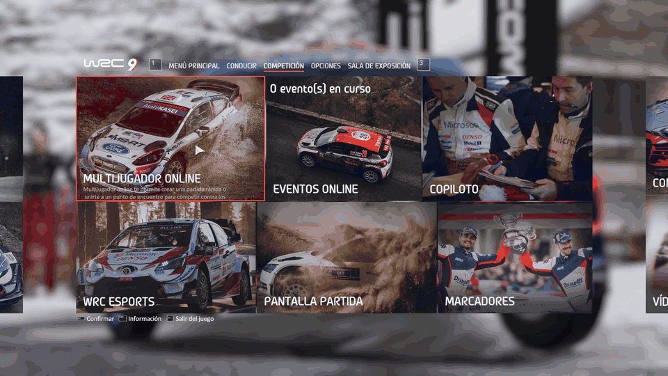

# WRC 9 LAN Revival

[English](README.md) | **Español**

Volvé a jugar el multijugador de *WRC 9 FIA World Rally Championship* con tus amigos. Los servidores oficiales están caídos, y por eso el juego dice **"debes estar conectado"**. Esta herramienta recupera el multijugador en red local, sin modificar ningún archivo del juego.

| Sistema | Estado |
| --- | --- |
| Ubuntu | ✅ Probado: dos PC crearon una sala, se unieron y jugaron. |
| Windows | ⚠️ Todavía sin probar. Debería funcionar; contanos cómo te va. |



## Qué necesitás

- WRC 9 de Steam, **actualizado a la misma versión en todas las PC**.
- Que todos estén en **la misma red**, por ejemplo la misma casa o el mismo Wi-Fi. Para casas distintas, ver [Jugar desde casas distintas](#jugar-desde-casas-distintas-experimental).
- Que **cada jugador** abra esta herramienta en su propia PC.

## 1. Descargar

Apretá el botón verde **Code**, arriba en esta página, y después **Download ZIP**. Descomprimilo donde quieras, por ejemplo en el Escritorio.

## 2. Abrir la herramienta

### Ubuntu

1. Cerrá WRC 9.
2. Abrí la carpeta `ubuntu`, hacé clic derecho en un espacio vacío y elegí **Abrir en una terminal**.
3. Escribí esto y apretá Enter:
   ```bash
   bash iniciar.sh
   ```
4. Escribí tu contraseña y apretá Enter. Mientras escribís no aparece nada en pantalla; es normal.
5. Esperá a que diga `KtOS local listo`. **Dejá la ventana abierta** mientras juegues.

### Windows

1. **Solo la primera vez:** instalá Python desde [python.org](https://www.python.org/downloads/). En el instalador, marcá **"Add python.exe to PATH"**.
2. Cerrá WRC 9.
3. Abrí la carpeta `windows` y hacé doble clic en **`INICIAR.bat`**.
4. Elegí **Sí** cuando Windows pida permiso. Si dice "Windows protegió tu PC", elegí **Más información** y después **Ejecutar de todas formas**.
5. Esperá a que diga `KtOS local listo`. **Dejá la ventana abierta** mientras juegues.

## 3. Jugar

1. Abrí WRC 9 desde Steam, como siempre. La ventana de la herramienta tiene que mostrar `Modo LAN forzado en memoria`.
2. **Un jugador** crea la sala: **Multijugador online → Crear punto de encuentro**.
3. **Los demás** se unen: **Multijugador online → Buscar punto de encuentro**.
4. Al terminar, cerrá el juego y después la ventana de la herramienta.

Cualquiera puede crear la sala. Nadie tiene que quedarse conectado para que los demás jueguen.

## ¿Algo no funciona?

| Qué ves | Qué hacer |
| --- | --- |
| "Debes estar conectado" | Cerrá el juego, abrí **primero** la herramienta y después el juego. |
| Nunca aparece `Modo LAN forzado en memoria` | Revisá que la herramienta se haya abierto con permisos de administrador (contraseña o "Sí"). |
| `no coincide con este build` | Tu versión del juego es distinta a la soportada. Actualizá WRC 9 en Steam y avisanos. |
| "No se encontraron partidas" | Casi siempre es el firewall. En Ubuntu probá `sudo ufw disable` (y después `sudo ufw enable`). Revisá también que las dos PC estén en el mismo Wi-Fi. |
| Windows: "Falta Python" | Instalá Python (paso 1) y volvé a abrir `INICIAR.bat`. |
| Aviso del antivirus | La herramienta modifica el archivo `hosts` y la memoria del juego. Podés leer exactamente qué hace en `windows/wrc9-ktos.py`. |

Si pasa otra cosa, ver [Opiniones y contacto](#opiniones-y-contacto).

## Jugar desde casas distintas (experimental)

Esto no está probado. Con [ZeroTier](https://www.zerotier.com/), todos se unen a la misma red virtual y el juego la ve como una red local. Después seguí los pasos de arriba como si estuvieran en la misma casa.

Tailscale no sirve para esto, porque no transmite el broadcast que usa el juego para encontrar salas.

## Para tener en cuenta

- No recupera los logros online, los clubes ni los rankings.
- No modifica archivos del juego. Mientras está abierta, redirige el servidor de login del juego a tu propia PC y activa un modo LAN que el juego trae oculto.
- Nunca compartas archivos del juego, solo esta herramienta.

## Opiniones y contacto

Quiero saber de vos **tanto si funciona como si no**. Cada reporte ayuda, sobre todo desde Windows, que todavía no está probado. Si algo falla, le busco una solución.

- Comentá en el [post de Reddit](https://www.reddit.com/r/WRCTheGame/comments/1xo7fvn/i_got_wrc_9_multiplayer_working_again_after_the/), o
- Abrí un [issue en GitHub](https://github.com/matiasoviedo28/WRC-9-LAN-Revival/issues), o
- Escribime a **[matiasalbertooviedogonzalez@gmail.com](mailto:matiasalbertooviedogonzalez@gmail.com)**.

Contame:

- Tu sistema: Ubuntu o Windows, y su versión.
- Si creaste la sala o te uniste a la de otro.
- Qué pasó, y el mensaje en pantalla si hubo alguno.
- El archivo `wrc9-ktos.log`, que aparece junto a la herramienta. No contiene contraseñas ni tu ticket de Steam.

## ¿Cómo funciona?

La historia completa, del error a la solución, está en las [notas técnicas](docs/TECNICO.md).
